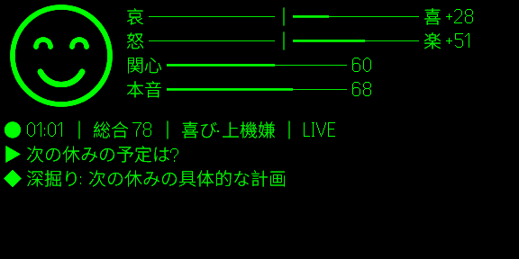

# even-playground

スマートグラス **Even Realities G2** 向けのアプリを、気軽に試すための遊び場です。
本命は `apps/scouter/`。会話相手の「状態」を推定して、グラスの端にスカウター風に出すアプリです。



- 喜怒哀楽・関心・本音をゲージで、顔アイコンと一言ラベルつき
- 「次に言う一言」と「深掘りポイント」を短く提案
- 判定は [Jev](https://typesafe.ai)(文章を書かない判定モデル、0.2 秒)、文章は Claude、文字起こしは手元の whisper.cpp

まだ PoC(試作)です。実機なしでも、公式シミュレータと Mac のマイクで一通り動きます。

## 動かしてみる

必要なもの: Node 22、[whisper-cpp](https://github.com/ggml-org/whisper.cpp)(`brew install whisper-cpp`)、ログイン済みの [Claude Code](https://claude.com/claude-code)、Even Hub の CLI とシミュレータ(`npm i -g @evenrealities/evenhub-cli @evenrealities/evenhub-simulator`)。

```bash
cd apps/scouter
npm install
npm run whisper:setup          # 音声認識モデル(1.6 GB)を取ってくる。最初の 1 回だけ
cp server/.env.example server/.env
npm run start                  # whisper + サーバ + 画面 + シミュレータがまとめて上がる
```

シミュレータのグラス画面をクリックするとマイクが入ります。Mac に向かって話してみてください。

### Jev を使う(任意)

`server/.env` に次の 2 行を足すと、数値の判定が Jev になり、グラスの反応が 0.2 秒になります。キーは [typesafe.ai](https://typesafe.ai) の waitlist で取れます。

```
TYPESAFE_API_KEY=取得したキー
LLM_PROVIDER=jev+claude-code
```

キーが無ければそのまま Claude だけの構成で動きます。API キーは `server/.env` にだけ置いてください(git には入りません)。

### 実機で使う

`npm run start:device` で QR コードが出るので、Even App でスキャンします。外出先からは Tailscale 経由で Mac に届きます。手順は [docs/setup-device.md](docs/setup-device.md) にあります。

## もっと知りたい

| 読みもの | 内容 |
|---|---|
| [docs/slides/scouter-jev/](docs/slides/scouter-jev/) | 勉強会のスライド(Marp)。何を作ったか、Jev をどう使ったか、測った数字 |
| [CLAUDE.md](CLAUDE.md) | 開発メモ。SDK の制約、守るべきルール、コマンド一覧(AI と人の両方向け) |
| [docs/workflow.md](docs/workflow.md) | 環境構築から実機テスト、パッケージまでの手順 |
| [docs/pitfalls.md](docs/pitfalls.md) | 引っかかりやすい所 |
| [docs/sdk-cheatsheet.md](docs/sdk-cheatsheet.md) | SDK API の早見表 |

## ライセンス

MIT。`docs/vendor/` には Even Realities 公式のドキュメント・SDK 型定義・テンプレートの写しが入っています(いずれも MIT、各フォルダに LICENSE あり)。
