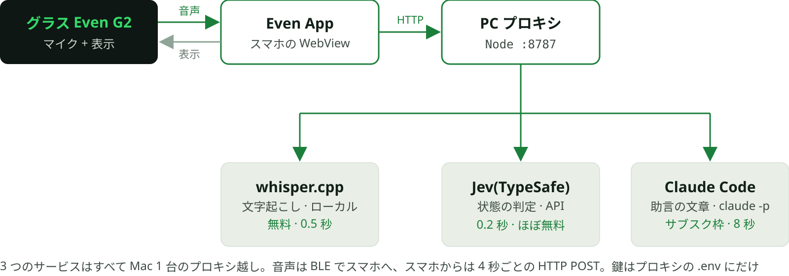
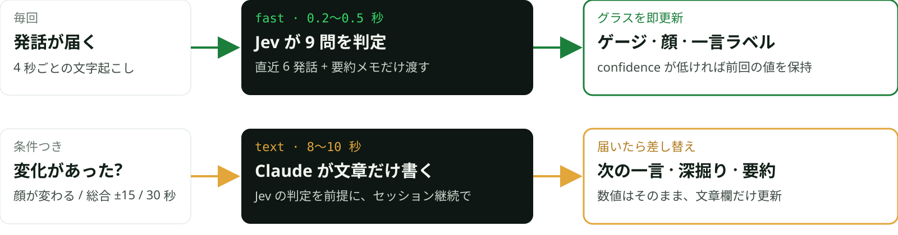
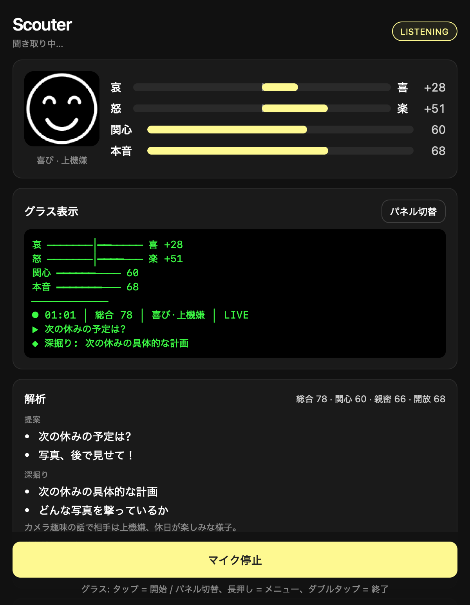

<!-- _class: dark center -->
<!-- _paginate: false -->
<!-- _header: '社内勉強会 · 2026-10 · PoC' -->

# Scouter

## 会話相手の「状態」をスマートグラスに出す

Even G2 × whisper.cpp × *Jev* × Claude Code


<!--
スマートグラス Even G2 向けに「会話相手の状態をスカウター風に表示する」アプリを PoC で作った話。
今日は何を作ったか、どう動かしたか、話題の判定モデル Jev をどこに組み込んだか、そしてデモ。
-->

---

<!-- _class: agenda center -->

## 今日の話

- **01 作ったもの** グラスに何が出るか、PoC で何を割り切ったか
- **02 どう実現したか** サービスの連携と、ローカルでの動かし方
- **03 Jev をどう使ったか** 文章を書かない判定モデルの使い所と設計
- **04 測った数字** 速さ・精度・コスト
- **05 デモ** シミュレータでライブ
- **06 引っかかった所と次** PoC で学んだこと、続けるなら何をするか

<!-- 6 つ。15〜20 分で、途中にデモを挟む。 -->

---

<!-- _class: dark -->
<!-- _header: '01 / 作ったもの' -->

## 相手を「スカウター」で見る

- **喜怒哀楽・関心・本音をゲージで** 会話の文字起こしから相手の状態を推定して数値に
- **顔アイコンと一言の状態ラベル** 「上機嫌」「疲れ」「警戒」など 10 種から
- **次に言う一言と深掘りポイント** そのまま口に出せる口語で 2 件まで


<!--
装着者が誰かと話している間、相手の発話だけから状態を推定してグラスの端に出す。
相手を操作するのではなく、気持ちを尊重して会話が良くなる助言にする、という方針。
-->

---

<!-- _class: alt cards -->
<!-- _header: '01 / 前提' -->

## Even G2 のアプリは「スマホで動く Web アプリ」

- **画面は小さく、緑一色** 576×288 px、4bit 緑モノクロ。CSS も DOM も無く、テキスト・リスト・画像の「コンテナ」を絶対座標で並べるだけ
- **ロジックは全部スマホ側** Even App 内の WebView で Vite + TypeScript が動く。グラスには一切ロジックが載らない
- **グラスは表示 + 入力デバイス** BLE 越しにタップ・スワイプ・マイクの PCM(16kHz)が届く。発話ごとに self / other の推定ラベル付き

公式シミュレータがあり、実機が無くても同じコードをそのまま動かせる

<!-- この制約が PoC の形を決めた。重い処理はスマホにも載せたくないので、PC 上のプロキシに全部寄せた。 -->

---

<!-- _class: cards -->
<!-- _header: '01 / 作る前にやったこと' -->

## まず AI に、公式ドキュメントとコミュニティの投稿を片っ端から読ませた

- **集めたもの** 公式ドキュメント一式、SDK の README と型定義、公式テンプレ、開発者コミュニティの投稿(実機で詰まった報告)。要点を `CLAUDE.md` と `docs/`(手順・落とし穴・API 早見表)に集約してから書き始めた
- **成果 1: 初手から無難に作れた** 「ダブルタップは確認ダイアログ付きで終了」「BLE 呼び出しは直列化」「絵文字は描画されない」など、レビュー落ち・実機で詰む系のルールを 12 条にして最初から守った
- **成果 2: 話者が 3 パターンで取れると判明** グラスのマイク音声には発話ごとに self(装着者)/ other(相手)/ unknown のラベルが付く。これで「相手の発話だけを解析する」設計が成立した(グラス側の推定なので保証はない)

<!--
作り始める前に、Claude Code に公式ドキュメントとコミュニティの投稿を読ませて、知見をリポジトリ内のドキュメントに溜めた。
コードを書く AI が毎回それを読むので、既知の落とし穴を踏まずに済んだ。話者ラベルの存在もここで知った。
-->

---

<!-- _class: dark cards -->
<!-- _header: '01 / PoC の割り切り' -->

## 「サクサク動くこと」を最優先に決めた 4 つ

- **実機を待たない** 公式シミュレータ + Mac のマイクで開発も検証もデモも。自動操作 API でスクショとタップをスクリプト化
- **文字起こしはローカル** whisper.cpp(large-v3-turbo)を Mac で常駐。無料・オフライン・1 チャンク 0.5 秒。クラウド STT の無料枠は 1 日 20 回で足りなかった
- **LLM は Claude Code のサブスク枠** API キーを新しく契約せず、ログイン済みの `claude -p` を子プロセスで叩く。構造化出力は `--json-schema`
- **鍵はスマホに載せない** PC 上の小さなプロキシ(Node、約 100 行)が STT・判定・LLM を全部仲介。スマホは音声を送って JSON を受けるだけ

<!-- PoC なので「ちゃんとした本番構成」より「今日動く」を優先した。この 4 つで、追加契約ゼロ、実機ゼロで動くところまで行けた。 -->

---

<!-- _header: '02 / どう実現したか' -->

## 全体の流れ: グラス → スマホ → PC の 3 つのサービス



<!--
左から右へ。グラスのマイク音声が BLE でスマホに入り、スマホの WebView が 4 秒分ずつ PC のプロキシへ送る。
プロキシが whisper で文字にし、Jev で状態を判定し、Claude Code で助言文を作って返す。結果はスマホがグラスに描く。
iOS の WebView で WebSocket が落ちる報告があるので HTTP POST にしている。
-->

---

<!-- _class: tight proxy -->
<!-- _header: '02 / PC プロキシの中身' -->

## 中身は 3 つのエンドポイント、約 100 行

| エンドポイント | 入力 → 出力 | 中でやること |
|---|---|---|
| `GET /health` | → 使っている STT / LLM、二段表示の可否 | クライアントが起動時に見て挙動を切り替える |
| `POST /transcribe` | PCM 16kHz(4 秒分)→ `{ text }` | 無音なら即返す → whisper-server(OpenAI 互換)→ 正規表現の幻聴リスト → Jev ゲート(noul) |
| `POST /analyze?stage=fast` | 直近の発話 + 前回の結果 → 数値 | Jev に 9 問を 1 リクエスト。confidence が低い顔・一言は前回値を保持 |
| `POST /analyze?stage=text` | 同上 → 助言・深掘り・要約・memory | `claude -p --json-schema` を子プロセスで起動。2 回目以降は `--resume` で新しい発話だけ渡す |

- **Web 標準の Request / Response だけで書いた**。Node と Cloudflare Workers は薄いアダプタで、同じ本体が動く
- **サービスは環境変数で差し替え**。`LLM_PROVIDER=jev+claude-code` のような合成も、`?provider=` での比較もできる
- **鍵と到達性**。Bearer 認証は任意、開発中は Vite の中継で同一オリジン、外出先は Tailscale で Mac へ

<!--
プロキシの役割は「鍵を持つ」「重い処理を Mac に寄せる」「サービスを差し替え可能にする」の 3 つ。
Web 標準の Request / Response だけで書いたので、Cloudflare Workers に置く時もアダプタを足すだけで済む。
-->

---

<!-- _class: alt tight -->
<!-- _header: '02 / ローカルで動かす' -->

## Mac 1 台、コマンド 1 つで全部上がる

**用意するもの**
- Node 22、Even Hub の CLI とシミュレータ
- whisper-cpp(brew)とモデル 1.6 GB(setup スクリプトで取得)
- Claude Code にログイン済みであること(`claude -p` を使う)
- TypeSafe の API キー(waitlist 登録で半日、5 ドル分付き)

```bash
# server/.env
LLM_PROVIDER=jev+claude-code
STT_GATE=jev
TYPESAFE_API_KEY=apikey_…
# whisper + プロキシ + Vite + シミュレータ(自動操作つきは -- --automation-port 9898)
npm run start
```

キーが無ければ従来の 1 段(Claude だけ)に自動で戻る。全部モックの `--mock` もある

<!-- 起動スクリプトが whisper-server、Node のプロキシ、Vite、シミュレータを順に立ち上げる。設定は .env の 3 行で、Jev のキーが無ければ従来の構成に戻るので段階的に試せる。 -->

---

<!-- _header: '02 / 使ったもの' -->

## 役割ごとに一番手軽なものを選んだ

| 役割 | 使ったもの | どこで動く | コスト | 選んだ理由 |
|---|---|---|---|---|
| 表示 · 入力 | Even Hub SDK 0.0.15 + 公式シミュレータ | スマホ WebView / Mac | 無料 | 実機なしで同じコードが動く |
| 文字起こし | whisper.cpp large-v3-turbo + VAD | Mac(Metal) | 無料 | 日本語精度が良く、無制限 |
| 状態の判定 | Jev(TypeSafe AI) | API | 入力 100 万 tok で 0.042 ドル、出力無料 | 0.2 秒で確率付きの判定が返る |
| 助言の文章 | Claude Code(`claude -p`、sonnet) | Mac の子プロセス | サブスク枠 | 追加契約なしで構造化出力 |
| 仲介 | Node のプロキシ(Web 標準 Request / Response) | Mac :8787 | 無料 | そのまま Cloudflare Workers にも置ける |

キーが要るのは Jev だけ。1 時間しゃべり続けても Jev 側は 0.03 ドル程度

<!-- Gemini の無料枠は 1 日 20 リクエストで足りず、クラウド STT も課金が要るので、文字起こしはローカル、LLM はサブスク枠、判定だけ Jev という組み合わせに落ち着いた。 -->

---

<!-- _class: dark cards -->
<!-- _header: '03 / Jev とは' -->

## 文章を書かない AI。判定だけを確率付きで返す

TypeSafe AI が 2026-09-15 に公開。元 OpenAI(InstructGPT)の研究者が創業。「スマートな if 文」。入力は JSON、出力は型の決まった値で、質問は 3 種類

- **`choice` 選択肢から 1 つ** 各候補の確率と confidence が返る
- **`score` 順序尺度の期待値** 喜びは 0〜3 のどこか
- **`noul` 真偽の確率** 「実際の発話か」が 0.93

<!-- LLM の代替ではなく、前段や横に置く「判定エンジン」。早期アクセス中で waitlist 登録が要る。 -->

---

<!-- _class: dark -->
<!-- _header: '03 / Jev の向き不向き' -->

## 速くて安い。ただし文章は書けず、字義通りに読む

| *メリット* | *デメリット* |
|---|---|
| 速い。1 回 0.2 秒で、質問を増やしても並列なので変わらない | 文章も音声も扱えない。生成が要る所は別モデル |
| 安い。入力 100 万トークンで 0.042 ドル、出力は無料 | 字義通りに読む。曖昧な基準・皮肉・多段推論に弱い(公式の弱点一覧) |
| 確率が較正されている。confidence で「自動 / 保留 / LLM に回す」を分岐できる | 日本語は英語より精度が落ちると公式が注記。自前データで要検証 |
| 嘘の文章を書かない。外れても「判定が外れる」形で済む | モデル版を固定できない(jev-latest / jev-preview のみ)。更新で分布が変わり得る |

<!-- 公式の弱点一覧(jaggedness)は設計のチェックリストとして使える。 -->

---

<!-- _class: dark code -->
<!-- _header: '03 / 使い方' -->

## リクエストは state + 質問、レスポンスは質問ごとの確率

```ts
// リクエスト(@typesafe-ai/sdk)。state は JSON、質問は何問でも 1 回で並列評価
const { answers, model, usage } = await client.systemOne({
  state: { task: '装着者(self)と相手(other)の対面会話。相手の今の状態を判定する',
           latest_other: 'ていうか、その話はもういいじゃないですか。',
           conversation: 'self: どんなカメラですか？\nother: え、それは…まあ、普通のやつですよ。\nother: ていうか…', memory: '…' },
  questions: {
    face:   choice('今の相手に最も近い表情は', { angry: { what: '不満・苛立ち・拒絶の言葉', not_for: '疲労の訴え(→tired)' }, happy: { … }, tired: { … } }),
    joy:    score('喜びの表現はどの程度あるか', ['表現がない', '軽い肯定(「いいですね」)', '明確な喜び・笑い', '強い喜び・感嘆']),
    speech: noul('実際に話された発話として自然か', { true: '会話として意味が通る', false: '字幕の定型句、無意味な繰り返し' }),
  },
})
// レスポンス(0.2 秒、出力トークン 0)。文章は一切無い
{ model: 'jev-1.13.0', usage: { input_tokens: 3072, output_tokens: 0 },
  answers: {
    face:   { type: 'choice', choice: 'angry', confidence: 0.96, probabilities: { angry: 0.97, neutral: 0.03, happy: 0 } },
    joy:    { type: 'score',  score: 0.12,  confidence: 0.90, probabilities: { 0: 0.90, 1: 0.08, 2: 0.02, 3: 0 } },
    speech: { type: 'noul',   noul: 0.91 },
  } }
```

アプリでは `score / 3 × 100` をゲージに、`choice` を顔と一言に、`noul` を幻聴ゲートの閾値に。`confidence` が低い時は前回の値を保持する

<!-- 実際のコードは server/jev.ts。質問は 9 問で、state は直近 6 発話 + 要約メモに絞る(大きい state で精度が落ちる公式注記)。答えが文章ではなく確率なので、閾値も合成もコード側で決められるのが使いやすい。 -->

---

<!-- _header: '03 / 使い所' -->

## Jev に任せた 2 つ、任せなかった 2 つ

| 任せた | 任せなかった |
|---|---|
| **相手の状態の判定** 喜怒哀楽 4 本(score)、表情 7 択と一言ラベル 10 択(choice)、関心・親密・本音(score)。合計 9 問を 1 回で | **音声を文字にすること** Jev はテキスト専用。whisper のまま |
| **文字起こしの幻聴ゲート** 「ご視聴ありがとうございました」など whisper が無音で吐く定型句を noul「実発話か」で捨てる。正規表現と併用 | **助言・要約の文章** 生成できないので Claude のまま。ただし「数値は Jev が出した前提で文章だけ書く」モードにして出力を半分に |

一言ラベルも文章は作れないので、上機嫌 / 乗り気 / 落ち着き / 様子見 / 警戒 / 退屈 / 疲れ / 苛立ち / 沈み / 驚き の候補から選ばせる

<!-- Jev は「判定」と「ふるい」。文章と音声は従来のまま。この線引きが決まると実装は素直になった。全部で 1 ファイル、300 行ほど。 -->

---

<!-- _class: alt -->
<!-- _header: '03 / 二段表示' -->

## 数値は Jev が即時、文章は Claude が「変わった時だけ」



シミュレータで 7 発話しゃべった時: Jev 6 回、Claude 3 回。グラスの反応は 0.2 秒、助言は数秒遅れて差し込まれる

<!-- 最初は Jev と Claude を並列に呼んで両方揃ってから返していた。それだと Claude の 8 秒に引っ張られて Jev の速さが死ぬ。/analyze を stage=fast と stage=text に分け、クライアントが呼び分ける形にした。Claude を呼ぶ回数が数分の一になる副作用もある。 -->

---

<!-- _header: '03 / 効いた設計' -->

## 精度を決めたのは「質問の書き方」だった

| 公式の弱点 | 最初に書いたもの | 直したもの |
|---|---|---|
| 曖昧な基準に弱い | 「わずかに感じられる / ある程度ある」 | 観察できる状況で: 「笑い・楽しかったという報告がある」 |
| 隣の選択肢と混ざる | 疲れ / 沈み / 退屈 を名前だけで並べた | 各候補に what と not_for を付けて境界を切る |
| 字義通りに読む | 前回の表情と一言を state に入れていた | 渡さない。相手の最新発話を別枠で渡し「最重視」と明記 |
| 計算が苦手 | 総合スコアも Jev に聞いていた | 関心・親密・感情の正負からコードで合成 |
| (較正を活かす) | confidence を見ていなかった | 0.5 未満は前回値を保持。ただし前回値が候補に残っている時だけ |

「前回の値を渡さない」だけで「疲れ」を引きずる固着が消えた(表情の一致 5/6 → 6/6)

<!-- LLM だと「文脈で察して」で済む部分が、Jev では全部こちらの書き方に跳ね返る。公式の弱点一覧をそのままチェックリストにした。話者が全部 unknown になるシミュレータでは「相手の最新発話」が空になって confidence が落ちる問題もあり、self 以外の最新発話を使うようにした。 -->

---

<!-- _class: dark numbers -->
<!-- _header: '04 / 測った数字' -->

## 判定は 40 倍速く、精度は Claude と並んだ

| | |
|---|---|
| 0.2〜0.5 秒 | **Jev の判定 9 問** p50 0.19 秒、約 3,000 トークン。並列 5 本でも劣化なし |
| 8〜10 秒 | **Claude Code の文章** CLI 起動 1.4 秒 + 7K トークンの前置き + 2〜3 ターン |
| 21 / 21 | **表情の一致(評価セット)** 6 会話 21 地点。一言ラベルも 21/21。Claude とは 6/6 一致 |
| 0.03 ドル | **Jev のコスト** 1 時間しゃべり続けた場合。出力は無料 |

- **幻聴ゲート**(幻聴 15 / 実発話 20): 閾値 0.6 で幻聴 13 件を除去、誤除去 0 件。残った「おやすみなさい」「ありがとうございました」は実会話でも言う言葉
- **モデルを替えても速くならない**: haiku は思考が暴走して 20〜40 秒、opus は 12 秒。sonnet のまま「呼ぶ回数と出力量を減らす」方が効いた

<!-- 評価セットは自分で書いた会話なので甘め。実会話を録って足すのが次。Claude Code が遅いのはモデルではなく CLI 経由のオーバーヘッドで、API を直接叩けば 2〜3 秒の見込みだが、サブスク枠で済ませる方針とのトレードオフ。 -->

---

<!-- _header: '05 / 実際の画面' -->

## スマホ側とグラス側


読み上げ音声「写真を撮るのが楽しくて、休みが待ち遠しい」の直後。タップでパネルが 提案 → 深掘り → スコア → 会話 と切り替わる。右はスマホ側



<!-- グラスは 576×288 の緑一色なので、ゲージは罫線素片で描いている。絵文字はフォントに無く無言で消える。顔は 7 種のビットマップ画像。右はスマホ側(Even App の WebView)で、設定・ログ・グラス表示のミラーが出る。 -->

---

<!-- _class: dark demo big tight -->
<!-- _header: '05 / ここでデモ' -->

## シミュレータでライブ

### 手順
1. `npm run start` でシミュレータを出す
2. グラスをタップしてマイク開始
3. Mac のマイクに向かって話す(2 人分を 1 人で)

### 見どころ
- 話した直後にゲージと顔が動く(*Jev*)
- 数秒遅れて「次の一言」が差し込まれる(*Claude*)
- 「その話はもういいです」で怒り顔に切り替わる
- スマホ側のログに各段階の秒数が出る

> うまく行かない時: 会場の環境音で余計な発話が混ざる / Claude の応答が 10 秒を超えることがある / 話者は全部 unknown になる(シミュレータは判別しない)

<!-- デモ前に起動しておく。疲れた話 → 楽しい話 → 急に不機嫌、の順で自分で演じると変化が分かりやすい。 -->

---

<!-- _class: cards -->
<!-- _header: '06 / 引っかかった所 1/2' -->

## PoC で踏んだもの: 判定と LLM

- **Jev は前回値に引きずられる** 前回の表情を渡すと「疲れ」が固着。渡すのをやめ、最新発話を最重視と書いて解消
- **話者が全部 unknown** シミュレータは判別しない。「相手の最新発話」が空になり confidence が落ちた。self 以外を相手扱いに
- **claude -p が遅い** リポジトリ内で起動すると CLAUDE.md を読んで 18K トークン。空ディレクトリで起動して 4K に。それでも 8 秒

<!-- どれも「動かしてみて初めて分かった」類。評価スクリプトと自動操作のシミュレータがあったので、直す → 測る のループが数分で回せた。 -->

---

<!-- _class: cards -->
<!-- _header: '06 / 引っかかった所 2/2' -->

## PoC で踏んだもの: 文字起こしとグラス

- **whisper の 4 秒境界** 文の途中で切れて「コーディング」と幻聴。直前の末尾を次の prompt に繋いで解消
- **無音でも whisper が喋る** 「ご視聴ありがとうございました」が延々出る。VAD + 正規表現 + Jev ゲートの三段構え
- **グラスの描画の罠** 絵文字は無言で消える、BLE 呼び出しは直列化しないと落ちる、protobuf のゼロ値は undefined で届く

<!-- グラス側の罠は SDK の仕様。docs/pitfalls.md にまとめてある。 -->

---

<!-- _class: alt cards -->
<!-- _header: '06 / 次にやるなら' -->

## PoC の先に残っているもの(優先度順)

- **実会話で評価セットを育てる** 録音モードで溜めた会話に正解を付けて、Jev のモデル更新時に自動で再確認する。今の 21 地点は自作で甘い
- **助言の 8 秒を縮める** Anthropic API を直接叩けば 2〜3 秒の見込み(サブスク枠は外れる)。Agent SDK で常駐セッションにする手も
- **実機で確認** 日本語フォントの描画、話者推定の精度、Android でバックグラウンドに落ちた時の復帰
- **音声そのものから判定** Jev 型の音声判定モデル(オープンウェイト、日本語)なら声のトーンが使える。文字起こしの誤りに左右されない

<!-- 優先度は上の 2 つ。実機は手元に用意できれば。音声判定は実験枝。 -->

---

<!-- _class: dark center -->
<!-- _header: 'まとめ' -->

## 判定は Jev、文章は LLM、音声はローカル。役割を分けたら PoC は数日で動いた

1. Jev は「文章を書かない」ぶん速くて安い。判定とふるいに使い、生成は任せない
2. 精度はプロンプトではなく質問の書き方で決まる。公式の弱点一覧がそのままチェックリスト
3. 速いものを先に出し、遅いものは変化した時だけ。体感は構成で決まる

コード: `[リポジトリ URL]` · 質問はこのあとで

<!-- 締め。リポジトリの URL は公開するなら差し替える。 -->
